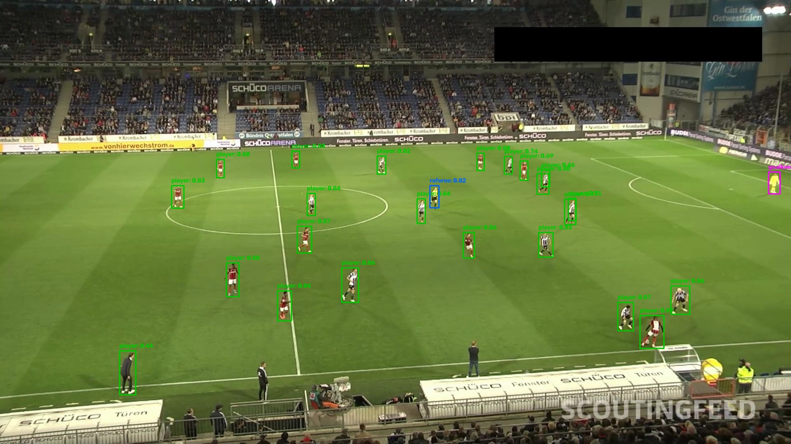
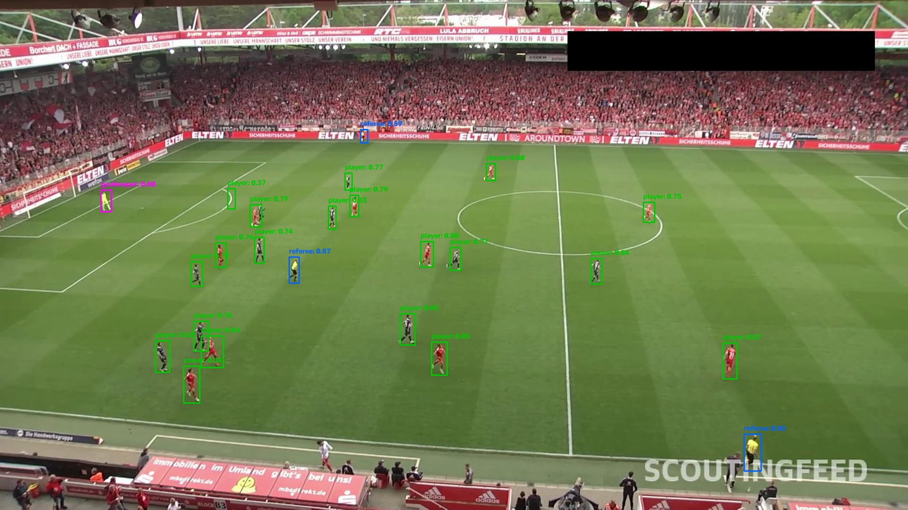
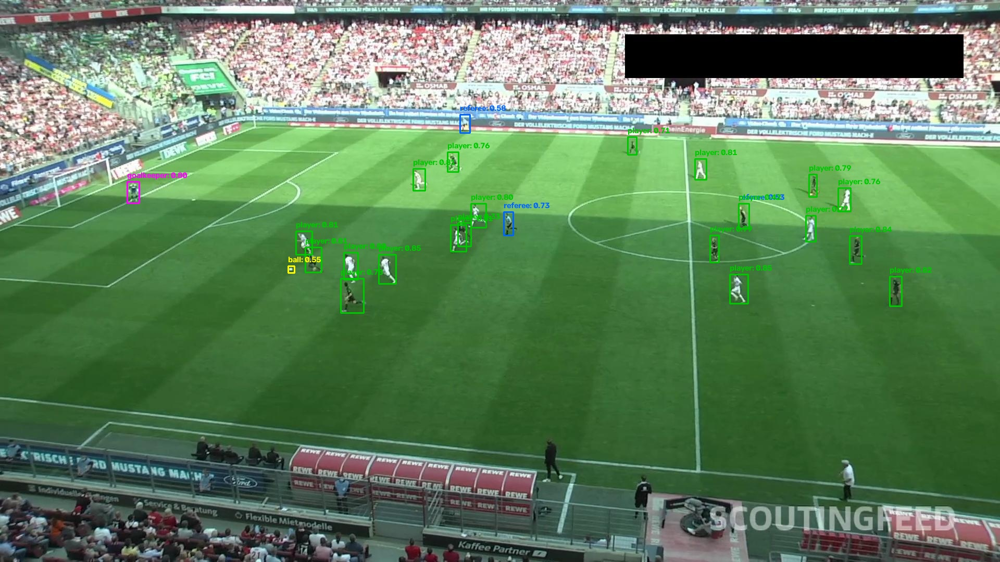

# Football Player Tracking & Analysis

A computer vision project for football match analysis, focused on detecting and tracking players, identifying key match entities, and eventually transforming broadcast footage into spatial and tactical insights.

The project is being developed as a modular and reproducible computer vision pipeline, with an emphasis on model evaluation, practical experimentation, and clear visual outputs.

## Project overview

The long-term goal is to build a system capable of:

- Detecting players, goalkeepers, referees, and the ball.
- Tracking detected objects across video frames with persistent IDs.
- Classifying teams based on player appearance and kit colors.
- Detecting pitch keypoints and estimating a homography.
- Projecting player positions onto a 2D tactical minimap.
- Generating annotated videos and structured match data.

## Current progress

The first detection model has been fine-tuned and evaluated on a football-specific dataset.

**Implemented**
- Modular project structure.
- Video reading and writing utilities.
- Configuration management.
- Detection interfaces and class definitions.
- Dataset validation and visualization tools.
- RF-DETR Nano fine-tuning for four football-specific classes.
- Independent test-set evaluation.
- Visual detection previews.

**In progress**
- Improving small-object detection, especially the ball.
- Building the tracking pipeline.
- Team classification.
- Pitch calibration and spatial analysis.

## Detection examples

The following examples show predictions from the fine-tuned RF-DETR Nano model.







*Images show model predictions, including bounding boxes, predicted classes, and confidence scores.*

## Model and training

| Setting | Value |
|---|---|
| Architecture | RF-DETR Nano |
| Framework | RF-DETR |
| Number of classes | 4 |
| Input base resolution | 384 |
| Training epochs | 20 |
| Batch size | 1 |
| Gradient accumulation | 4 |
| Optimizer | AdamW |
| Learning rate | 0.0001 |
| Hardware | NVIDIA RTX 3060 Ti (8 GB VRAM) |
| Training precision | Automatic mixed precision |
| Multi-scale training | Enabled |

The model was fine-tuned from pretrained RF-DETR Nano weights using a football-specific detection dataset.

## Dataset

Training and evaluation use the [Football Players Detection dataset](https://universe.roboflow.com/roboflow-jvuqo/football-players-detection-3zvbc/dataset/1).

The dataset contains four classes:

| Class | Description |
|---|---|
| `ball` | Football |
| `goalkeeper` | Goalkeeper |
| `player` | Outfield player |
| `referee` | Match referee |

Dataset split:

| Split | Images |
|---|---:|
| Train | 612 |
| Validation | 38 |
| Test | 13 |
| **Total** | **663** |

The dataset is distributed under the **Creative Commons Attribution 4.0 International (CC BY 4.0)** license. Please refer to the original dataset page for attribution and license terms.

Dataset files are not included in this repository.

## Evaluation results

The fine-tuned model was evaluated on the independent test split.

| Metric | Result |
|---|---:|
| mAP@50:95 | 0.4589 |
| mAP@50 | 0.7704 |
| mAP@75 | 0.4969 |
| Precision | 0.9644 |
| Recall | 0.7187 |
| F1-score | 0.7865 |
| mAR | 0.5209 |

### Per-class AP@50:95

| Class | AP@50:95 |
|---|---:|
| Ball | 0.1250 |
| Goalkeeper | 0.6467 |
| Player | 0.5874 |
| Referee | 0.4764 |

### Evaluation notes

The model achieves high precision, while recall indicates that some objects are still missed.

Ball detection is the main weakness, which is consistent with the difficulty of detecting small objects in football footage.

The test split contains only 13 images. These results are therefore an initial evaluation rather than a definitive benchmark. A larger and more diverse test set will be needed for a robust assessment.

## Repository structure

```text
football-player-tracking/
├── assets/
│   └── demo/
├── configs/
│   ├── default.yaml
│   └── experiments/
├── data/
│   ├── input/
│   ├── raw/
│   ├── processed/
│   └── annotations/
├── experiments/
│   ├── train_rfdetr.py
│   ├── evaluate_rfdetr.py
│   ├── evaluate_rfdetr_test.py
│   ├── test_rfdetr.py
│   ├── test_rfdetr_football.py
│   └── visualize_rfdetr_test.py
├── notebooks/
├── outputs/
├── scripts/
├── src/
│   └── football_tracking/
│       ├── video/
│       ├── detection/
│       ├── tracking/
│       ├── classification/
│       ├── calibration/
│       ├── analytics/
│       ├── visualization/
│       └── pipeline/
├── tests/
├── requirements.txt
└── README.md
```

## Environment

The RF-DETR experiments were developed and tested with:

- Windows
- Python 3.12
- PyTorch 2.11.0 with CUDA 12.8
- Torchvision 0.26.0
- RF-DETR 1.11.2
- NVIDIA RTX 3060 Ti (8 GB VRAM)

The experimental RF-DETR environment is separate from the project's base environment.

## Running the experiments

Activate the experimental environment:

```powershell
.\.venv-detectors\Scripts\Activate.ps1
```

Validate the training dataset and configuration:

```powershell
python experiments/train_rfdetr.py --check-only
```

Start fine-tuning:

```powershell
python experiments/train_rfdetr.py
```

Evaluate the trained model on the test split:

```powershell
python experiments/evaluate_rfdetr_test.py
```

Generate annotated test images:

```powershell
python experiments/visualize_rfdetr_test.py
```

The training and evaluation scripts expect the dataset to be available locally under:

```text
data/raw/football_players_detection/
```

The trained checkpoint and generated experiment outputs are stored locally and are not included in the repository.

## Roadmap

- [x] Initial project structure and configuration.
- [x] Video input/output utilities.
- [x] Detection interfaces and class definitions.
- [x] Football dataset validation.
- [x] RF-DETR Nano fine-tuning.
- [x] Independent test-set evaluation.
- [x] Visual detection previews.
- [ ] Improve ball detection and evaluate on more footage.
- [ ] Integrate multi-object tracking.
- [ ] Implement team classification.
- [ ] Detect pitch keypoints.
- [ ] Estimate pitch homography.
- [ ] Generate a 2D tactical minimap.
- [ ] Export structured tracking data and annotated match videos.
- [ ] Build a complete end-to-end analysis pipeline.

## License and attribution

The Football Players Detection dataset is provided under **CC BY 4.0**. Its original source and attribution must be preserved when redistributing or using the dataset.

RF-DETR is distributed under the Apache-2.0 license according to its model configuration. Refer to the upstream project for the applicable license terms.

The license for this repository's own code has not yet been specified.

---

*This project is under active development. Results and features will be updated as the detection, tracking, and spatial-analysis components mature.*